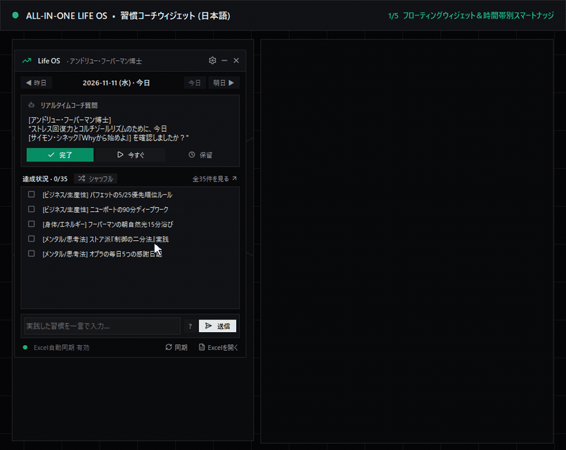

# 🌟 ALL-IN-ONE LIFE OS : 成功習慣35項目＆AIコーチシステム（Excel + 浮動ウィジェット）

> 🌐 **Languages:** [🇺🇸 English](README.md) · [🇰🇷 한국어](README.ko.md) · **🇯🇵 日本語** · [🇨🇳 简体中文](README.zh.md)

> **「卓越とは一度の行動ではなく習慣である。」 — アリストテレス**

---

## 🎬 デモ動画（日本語 UI）



* 🎥 [MP4 動画版 (`assets/demo_ja.mp4`)](assets/demo_ja.mp4) *(※ 外部 Bot トークン設定画面はデモ動画から省略しています。Telegram / Discord / ローカル Webhook の連携手順は [BOT_INTEGRATION_GUIDE.ja.md](BOT_INTEGRATION_GUIDE.ja.md) をご覧ください。)*

---

## 🎯 主な特徴

1. **7領域 × 5習慣 ＝ 35大成功習慣マスター:**  
   ビジネス/生産性・身体/エネルギー・メンタル・創造/学習・人間関係/リーダーシップ・資産/財務・システム/習慣化の 35 ルーチンを体系化（出典一覧: [`REFERENCES.ja.md`](REFERENCES.ja.md)）。
2. **ローカル完結 SQLite × Excel 5シート双方向同期 (`Life_OS_Successful_Habits.xlsx`):**  
   `📊 ダッシュボード`・`🏆 成功習慣DB`・`📅 日次トラッカー`・`📈 週次レビュー`・`🤖 AI連携ログ` をリアルタイム同期（全集計数式に `IFERROR` を適用済み）。
3. **デスクトップ常駐ウィジェット (`LifeOS_Assistant_v2.exe`):**
   * **グローバルホットキー (`Ctrl + Shift + H`)** ＆ システムトレイ常駐
   * **リアルタイム透明度スライダー (`30%〜100%`)**: 横スライダーを動かしながらウィジェット透明度を即時プレビュー（未保存キャンセル時は自動で元に戻ります）
   * **時間帯別スマートナッジ (`HABIT_ALLOWED_HOURS`)**: 朝の日光・午前意思決定・早朝執筆・就寝前デトックス・夕方のシャットダウンなど時間帯に紐づく習慣を適切な時間帯のみ出題し、それ以外の習慣はランダムに出題
   * **4人のロールモデルメンター**: A・フーバーマン / W・バフェット / イーロン・マスク＆Grok / マルクス・アウレリウス
   * **相対日付ボタン (`◀ 昨日/前日` · `今日` · `明日 ▶/翌日 ▶`)**: 今日以外を見ている時は自動で「前日 / 翌日」表記に切り替わります
   * **4言語ホットスイッチ (`ko`/`en`/`ja`/`zh`)**: OS言語の自動判定および設定画面からの即時切り替えに対応

---

## 🚀 クイックスタート

### 方法 A: Windows 単独実行ファイル (`.exe`)
GitHub **[Releases](https://github.com/hobby-programmer-5000/life-os-excel-ai/releases)** から `LifeOS_Assistant_v2.exe` をダウンロードしてダブルクリックするだけで起動します（Python 不要・初回起動時に同一フォルダへ DB と Excel を自動生成）。

> **Windows SmartScreen ＆ 整合性確認:** 有料コード署名証明書を持たない個人オープンソース製バイナリのため、初回起動時に「Windows によって PC が保護されました」と表示される場合があります（「詳細情報」→「実行」）。各リリースの SHA-256 ハッシュ（`certutil -hashfile LifeOS_Assistant_v2.exe SHA256`）で検証するか、[`build_exe.py`](build_exe.py) でソースから直接ビルドできます。

### 方法 B: ソースコードから実行（Windows / macOS / Linux）
```bash
git clone <repository-url>
cd life-os-excel-ai
pip install -r requirements.txt

python main_app.py
# CLI自然文チェックイン例:
python ai_secretary.py --checkin "朝15分日光を浴びて90分ディープワーク完了"
```

---

## 🔗 関連ドキュメント・検証

* [🤖 Telegram / Discord / スマホショートカット連携ガイド (`BOT_INTEGRATION_GUIDE.ja.md`)](BOT_INTEGRATION_GUIDE.ja.md) *(※ 外部アプリ側のアップデートによるUI変更注意を含む)*
* [🛠️ 開発ヒストリー・役割分担 (`DEVELOPMENT_HISTORY.ja.md`)](DEVELOPMENT_HISTORY.ja.md)
* [📚 出典・参考文献一覧（習慣 ＋ モダンミニマル UI/HCI 文献含む）(`REFERENCES.ja.md`)](REFERENCES.ja.md) · [📐 Harness² 設計仕様 (`HARNESS_SPEC.ja.md`)](HARNESS_SPEC.ja.md)
* [📜 商用フリー素材クレジット・ライセンス表記 (`THIRD-PARTY-NOTICES.md`)](THIRD-PARTY-NOTICES.md) — **Lucide Icons** (`ISC License` / Feather `MIT License`) 29種を正規収録
* 個人データ（`*.db`, `*.xlsx`, `.env`, `*.spec`, `build/`, `dist/`）は `.gitignore` と `build_exe.py` のアーカイブ検証により除外されています。

---

## 👥 共同貢献者 (Contributors)

* **[hobby-programmer-5000](https://github.com/hobby-programmer-5000)** — *Product Owner · Domain Architect · UX/UI Director · Real-Device QA*: 35習慣フレームワーク構想、Harness²/Excel中心アーキテクチャ設計、外部有料LLM API撤廃、**モダンミニマル（「Anti-Slop」）UI** 刷新・成長グラフアイコン選定・商用無料素材/UI文献準拠方針の策定、実機利用 UX 改善（動的日付ボタン・時間帯別ナッジ・リアルタイム透明度スライダー・Bot カード順整理）、プライバシー基準・オープン API 方針決定。
* **[Gemini (Antigravity)](https://github.com/gemini-code-assist)** — *AI Pair Programmer · Full-Stack, UI & QA Engineer*: [`ui_theme.py`](ui_theme.py)（60-30-10 トークン＋SVG ラスタライザ）・29種 Lucide 統合・Pythonコア・SQLite WAL 3-Way同期・Tkinter UI全面刷新・4言語i18n・Telegram/Discord/LAN Webhook実装・PyInstallerプライバシー検証・回帰/E2Eテスト・サンドボックスデモ動画・[`THIRD-PARTY-NOTICES.md`](THIRD-PARTY-NOTICES.md) ＆ UI参考文献執筆。

---

## 📄 ライセンス ＆ 素材クレジット (License & Stock Credits)

本プロジェクトは [MIT License](LICENSE) のもとで公開されています。UI アイコン素材は **Lucide Icons** ([lucide.dev](https://lucide.dev), `ISC License` / Feather `MIT License`) を使用しており、全文を [`THIRD-PARTY-NOTICES.md`](THIRD-PARTY-NOTICES.md) に記載しています。
