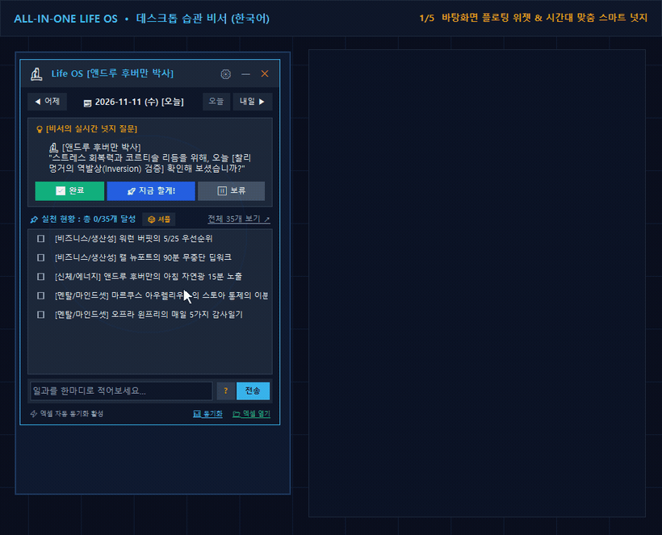

# 🌟 ALL-IN-ONE LIFE OS : 성공한 사람들의 습관 & 실행 시스템 (엑셀 + AI 비서)

> 🌐 **Languages:** [🇺🇸 English](README.md) · **🇰🇷 한국어** · [🇯🇵 日本語](README.ja.md) · [🇨🇳 简体中文](README.zh.md)

> **"탁월함은 행동이 아니라 습관이다." — 아리스토텔레스**

---

## 🎬 실행 데모 영상 (한국어 UI)



* 🎥 [MP4 고화질 데모 영상 (`assets/demo_ko.mp4`)](assets/demo_ko.mp4) *(※ 봇 토큰 등 개인 연동 화면은 데모 영상에서 생략했으며, Telegram · Discord · LAN 웹훅 설정은 [BOT_INTEGRATION_GUIDE.ko.md](BOT_INTEGRATION_GUIDE.ko.md) 에서 확인하실 수 있습니다.)*

---

## 🎯 제작 배경 및 개발 동기 (Motivation)

1. **검증된 성취 습관의 분야별 체계화 필요성**  
   생산성·신체 에너지·멘탈·지적 성장·리더십·자산 관리·루틴 시스템 등 각 분야에서 세계적 성과를 낸 인물들의 핵심 습관을 **7대 라이프 영역 × 5개 핵심 루틴(= 35대 일과)** 으로 정렬해 한눈에 관리할 수 있도록 구성했습니다.
2. **특정 플랫폼에 종속되지 않는 '엑셀(Excel)' 중심 설계**  
   폐쇄형 유료 서비스에 데이터를 맡기기보다, 내 PC에 영구 소장하고 직접 분석할 수 있는 **표준 엑셀(`.xlsx`) + 로컬 SQLite WAL(`life_os.db`)** 양방향 아키텍처로 설계했습니다.
3. **바탕화면 능동형 비서 · 다국어 · 개방형 모바일 봇 확장**  
   단독 실행 파일(`LifeOS_Assistant_v2.exe`), 실시간 투명도 가로 슬라이더, 시간대별 스마트 넛지, 그리고 Telegram·Discord·Android/Wi-Fi 웹훅까지 하나로 통합했습니다.

> 📚 **35대 일과 선정 근거 및 전체 참고문헌:** [`REFERENCES.ko.md`](REFERENCES.ko.md) · **공동 개발 과정 기록:** [`DEVELOPMENT_HISTORY.ko.md`](DEVELOPMENT_HISTORY.ko.md)

---

## 📁 프로젝트 파일 구성

* **코어 & 데이터베이스:** [`ai_secretary.py`](ai_secretary.py) · [`database.py`](database.py) · [`assistant_engine.py`](assistant_engine.py) · [`generate_excel.py`](generate_excel.py)
* **모던 미니멀 UI & 빌드:** [`main_app.py`](main_app.py) · [`floating_widget.py`](floating_widget.py) · [`ui_theme.py`](ui_theme.py) · [`tray_manager.py`](tray_manager.py) · [`hotkey_manager.py`](hotkey_manager.py) · [`app_icon.py`](app_icon.py) · [`build_exe.py`](build_exe.py)
* **4개 국어 지원 (`ko/en/ja/zh`):** [`i18n.py`](i18n.py) · [`i18n_habits.py`](i18n_habits.py) · [`i18n_personas.py`](i18n_personas.py)
* **모바일 봇 & 웹훅 브릿지:** [`telegram_bot.py`](telegram_bot.py) · [`discord_bot.py`](discord_bot.py) · [`bot_commands.py`](bot_commands.py) · [`bot_bridge.py`](bot_bridge.py)
* **문서 · 스톡 고지 · 검증:** [`DEVELOPMENT_HISTORY.ko.md`](DEVELOPMENT_HISTORY.ko.md) · [`REFERENCES.ko.md`](REFERENCES.ko.md) · [`HARNESS_SPEC.ko.md`](HARNESS_SPEC.ko.md) · [`BOT_INTEGRATION_GUIDE.ko.md`](BOT_INTEGRATION_GUIDE.ko.md) · [`THIRD-PARTY-NOTICES.md`](THIRD-PARTY-NOTICES.md) · [`test_regression_suite.py`](test_regression_suite.py) · [`test_e2e_scenarios.py`](test_e2e_scenarios.py)

---

## 🖥️ 주요 기능 (`LifeOS_Assistant_v2.exe`)

1. **글로벌 단축키 (`Ctrl + Shift + H`) & 시스템 트레이:** 어떤 작업 중이든 단축키로 위젯을 즉시 팝업/숨김 전환
2. **실시간 투명도 가로 슬라이더 (`⚙️ 설정`):** 숫자 입력 대신 **`30% ~ 100%` 가로 슬라이더**를 드래그해 실시간 미리보기(저장 없이 닫으면 자동 복원)
3. **시간대별 스마트 넛지 & 4대 거인 페르소나:**
   * **앤드루 후버만 / 워런 버핏 / 일론 머스크 & Grok / 마르쿠스 아우렐리우스** 중 멘토 선택
   * 시간이 포함된 습관(새벽 기상, 아침 자연광, 오전 의사결정, 저녁 셧다운, 취침 전 디톡스·감사일기 등)은 해당 시간대에만 묻고, 시간 제한 없는 습관은 무작위로 추천
4. **동적 날짜 탐색 (`◀ 어제` / `◀ 전날` · `오늘` · `내일 ▶` / `다음날 ▶`):** 오늘 기준이 아닐 때는 `◀ 전날` / `다음날 ▶`로 자동 전환되며 과거 소급 기록 및 미래 계획 메모 지원
5. **표시 방식 커스텀 (`1~35개` 핀·셔플 / `35개 전체 스크롤`) & `[?]` 키워드 검색 팝업:** 위젯 내 `[?]` 버튼에서 키워드를 검색·클릭해 한 줄 자연어 체크인 입력
6. **4개 국어 자동 감지 & 실시간 전환:** `⚙️ 설정`에서 한국어 / English / 日本語 / 简体中文 변경 시 UI · 트레이 · SQLite · 엑셀 시트 즉시 전환

---

## 📊 엑셀 워크북 5시트 구성 (`Life_OS_Successful_Habits.xlsx`)

1. **`📊 대시보드`**: KPI 카드, 워런 버핏 5/25 우선순위 Top 5, AI 비서 코칭 요약 박스, 7대 영역 달성률 신호등 (`#DIV/0!` 방지 `IFERROR` 적용)
2. **`🏆 성공인 습관DB`**: 35대 습관 번호·영역·롤모델·철학·체크리스트·난이도 마스터 DB
3. **`📅 일일트래커`**: 35대 습관 × 주간 7일(`1` 입력 시 달성률·스트릭 자동 수식 계산)
4. **`📈 주간회고`**: KPT 프레임워크 회고 및 AI 비서 주간 종합 평가
5. **`🤖 AI비서 연동로그`**: 연동 채널(Widget, Telegram, Discord, Android, CLI 등)별 체크인 및 코칭 기록

---

## 🚀 실행 방법 & 모바일 봇 연동

### 방법 A: Windows 단독 실행 파일 (`.exe`)
GitHub **[Releases](https://github.com/hobby-programmer-5000/life-os-excel-ai/releases)**에서 `LifeOS_Assistant_v2.exe`를 내려받아 바로 실행하세요(Python 불필요). 첫 실행 시 실행 파일과 같은 폴더에 `life_os.db`와 `Life_OS_Successful_Habits.xlsx`가 자동 생성됩니다.

> **Windows SmartScreen & 무결성 확인 안내:** 유료 코드 서명 인증서가 없는 순수 오픈소스 `.exe`이므로 첫 실행 시 *"Windows의 PC 보호"* 창이 표시될 수 있습니다(`추가 정보` → `실행`). 릴리즈 노트에 게시된 SHA-256 체크섬(`certutil -hashfile LifeOS_Assistant_v2.exe SHA256`)으로 파일 무결성을 대조하거나 [`build_exe.py`](build_exe.py)로 소스에서 직접 빌드해 사용하실 수 있습니다.

### 방법 B: 소스 코드 실행 (Windows / macOS / Linux)
```bash
git clone <repository-url>
cd life-os-excel-ai
pip install -r requirements.txt
python main_app.py
```

### 방법 C: 모바일 봇 & 웹훅 연동 (`⚙️ 설정 → 🌐 모바일 봇/웹훅...`)
* **Telegram 봇** · **Discord 내장 봇** · **Android `HTTP Request Shortcuts` · 보조 iPhone 공기계(Wi-Fi `단축어`)** 지원
* 상세 설정, `@BotFather` 사칭 봇 주의사항, Android `http://` / `Custom Text JSON` 팁, **플랫폼 업데이트에 따른 메뉴 변경 가능성 안내**는 [`BOT_INTEGRATION_GUIDE.ko.md`](BOT_INTEGRATION_GUIDE.ko.md) 를 참고하세요.
* 개인 DB(`*.db`), 엑셀(`*.xlsx`), `.env`, 빌드 산출물은 `.gitignore` 및 `build_exe.py` 보안 검사(`verify_clean_exe_bundle`)로 Git 푸시 및 `.exe` 번들에서 자동 제외됩니다.

---

## 👥 공동 기여 및 개발 히스토리

| 기여자 | 역할 | 주요 기여 영역 |
| :--- | :--- | :--- |
| **[hobby-programmer-5000](https://github.com/hobby-programmer-5000)** | **Product Owner · Domain Architect · UX/UI Director · 실기기 QA** | 35대 성공 습관 프레임워크 & 엑셀 중심 아키텍처 기획, Harness² · 무비용 로컬 NLP 방향 확정, **모던 미니멀("Anti-Slop") UI 개편** · 성장 그래프 아이콘 통일 · 상업적 무료 스톡 및 UI 디자인 문헌 고지 기준 수립, 실사용 바탕화면·모바일 실기기 QA, 개방형 API 범위 · MIT 라이선스 확정 |
| **[Gemini (Antigravity)](https://github.com/gemini-code-assist)** | **AI Pair Programmer · Full-Stack, UI & QA Engineer** | [`ui_theme.py`](ui_theme.py)(60-30-10 옵시디언 토큰 + SVG 래스터라이저) & Lucide 29종 스톡 통합, 플로팅 위젯 전면 UI 리뉴얼, Python 코어 · SQLite WAL 3-Way Sync, 4개 국어 i18n, Telegram/Discord/웹훅 브릿지, `.exe` 빌드 프라이버시 가드, 자동 회귀/E2E 검증, 샌드박스 데모 영상 및 다국어 문서 · 서드파티 고지 작성 |

* [🛠️ 단계별 개발 히스토리 및 역할 분담 상세 (`DEVELOPMENT_HISTORY.ko.md`)](DEVELOPMENT_HISTORY.ko.md)
* [📚 35대 습관 & UI/HCI 디자인 참고문헌 (`REFERENCES.ko.md`)](REFERENCES.ko.md) · [📐 Harness² 설계 규격 (`HARNESS_SPEC.ko.md`)](HARNESS_SPEC.ko.md)
* [📜 상업적 무료 스톡 아이콘 저작권 고지 (`THIRD-PARTY-NOTICES.md`)](THIRD-PARTY-NOTICES.md) — **Lucide Icons** (`ISC License` / Feather `MIT License`) 29종 수록

---

## 📄 라이선스 & 무료 스톡 크레딧 (License & Credits)

본 프로젝트는 [MIT License](LICENSE)로 배포됩니다. UI 및 앱 아이콘에는 상업적 이용이 자유로운 **Lucide Icons** ([lucide.dev](https://lucide.dev), `ISC License` / Feather `MIT License`)를 사용했으며 상세 고지는 [`THIRD-PARTY-NOTICES.md`](THIRD-PARTY-NOTICES.md) 에서 확인하실 수 있습니다.
