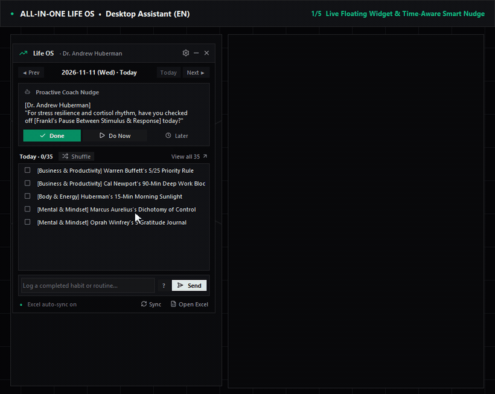

# 🌟 ALL-IN-ONE LIFE OS : Science-Backed Habits & AI Assistant (Excel + Floating Widget)

> 🌐 **Languages:** **🇺🇸 English** · [🇰🇷 한국어](README.ko.md) · [🇯🇵 日本語](README.ja.md) · [🇨🇳 简体中文](README.zh.md)

> **"Excellence, then, is not an act, but a habit." — Aristotle**

---

## 🎬 Live Demo (English UI)



* 🎥 [MP4 Video Version (`assets/demo_en.mp4`)](assets/demo_en.mp4) *(Note: External messenger bot setup is omitted in the demo video; see [BOT_INTEGRATION_GUIDE.md](BOT_INTEGRATION_GUIDE.md) for Telegram, Discord, and LAN webhook setup.)*

---

## 🎯 Motivation & Core Architecture

1. **Structured Synthesis of 35 Science- & Mentor-Backed Habits:**  
   Distills proven daily protocols across **7 core life domains × 5 habits = 35 daily actions** into one unified tracking matrix (see full citations in [REFERENCES.md](REFERENCES.md)).
2. **Local-First Excel Ownership (`Life_OS_Successful_Habits.xlsx`):**  
   Instead of locking your life logs inside a paid closed platform, all metrics live in a local SQLite WAL database (`life_os.db`) synced two-way with a **5-sheet formula-driven Excel workbook**.
3. **Zero-Friction Desktop Assistant (`LifeOS_Assistant_v2.exe`):**  
   A lightweight translucent floating widget (`30%–100%` real-time slider), system tray app, global hotkey (`Ctrl + Shift + H`), time-of-day smart nudges, and **100% offline local 4-language NLP check-ins** (zero API tokens or external paid keys required).

---

## ✨ Key Highlights

* **🎨 Modern Minimal "Anti-Slop" UI (`ui_theme.py`, `floating_widget.py`, `app_icon.py`):**
  * Calm **60-30-10 Obsidian & Zinc** surface hierarchy with `1px` hairlines, zero neon/emoji clutter, and single-CTA focus grounded in primary HCI literature ([REFERENCES.md](REFERENCES.md)).
  * Powered by **29 commercially free Lucide SVG icons** (`ISC License`, see [THIRD-PARTY-NOTICES.md](THIRD-PARTY-NOTICES.md)) and a unified **Growth Graph** desktop icon.
* **🖥️ Floating Desktop Widget & Tray App (`main_app.py`, `floating_widget.py`):**
  * Frameless always-on-top widget with **real-time horizontal opacity slider (`30%–100%`)** (live preview + revert on cancel).
  * **Global Hotkey (`Ctrl + Shift + H`)** + soft chime audio & OS toast reminders.
  * **Custom Mode (`1–35` pinned/shuffled habits)** or **Inline All-35 Scroll Mode**.
* **🕰️ Multi-Temporal Traversal & Dynamic Navigation:**
  * Navigate freely across yesterday, past days, today, or upcoming planned days (`◀ Prev` / `Today` / `Next ▶`, with contextual relative labels in Korean/Japanese/Chinese).
* **⏰ Time-of-Day Aware Smart Nudge Engine (`assistant_engine.py`):**
  * Combines random variety across timeless habits with strict time-window awareness (`HABIT_ALLOWED_HOURS`), so dawn/morning habits aren't nudged late at night and bedtime/shutdown rituals are never nudged at dawn or noon.
  * 4 selectable mentor personas: **Dr. Andrew Huberman**, **Warren Buffett**, **Elon Musk & Grok**, and **Marcus Aurelius**.
* **🌍 4-Language Native Experience (`ko` / `en` / `ja` / `zh`):**
  * Automatically detects OS locale on first launch and supports live UI, tray, SQLite, and Excel hot-switching inside **`⚙️ Settings`**.
* **💬 Open Messenger & Local Webhook Integrations (Optional):**
  * Built-in zero-dependency **Telegram Bot**, **Discord Gateway v10 Bot**, and **LAN HTTP Webhook Bridge** (`Android HTTP Request Shortcuts` / `MacroDroid`, Wi-Fi spare iPhone `Shortcuts`).
  * Full instructions & platform update caveats: [BOT_INTEGRATION_GUIDE.md](BOT_INTEGRATION_GUIDE.md).

---

## 📁 Project Structure

* **Core & Storage:** [`ai_secretary.py`](ai_secretary.py) · [`database.py`](database.py) · [`assistant_engine.py`](assistant_engine.py) · [`generate_excel.py`](generate_excel.py)
* **Modern Minimal UI & Packaging:** [`main_app.py`](main_app.py) · [`floating_widget.py`](floating_widget.py) · [`ui_theme.py`](ui_theme.py) · [`tray_manager.py`](tray_manager.py) · [`hotkey_manager.py`](hotkey_manager.py) · [`app_icon.py`](app_icon.py) · [`build_exe.py`](build_exe.py)
* **Localization (`ko/en/ja/zh`):** [`i18n.py`](i18n.py) · [`i18n_habits.py`](i18n_habits.py) · [`i18n_personas.py`](i18n_personas.py)
* **Mobile Bots & Bridge:** [`telegram_bot.py`](telegram_bot.py) · [`discord_bot.py`](discord_bot.py) · [`bot_commands.py`](bot_commands.py) · [`bot_bridge.py`](bot_bridge.py)
* **Docs, Notices & Tests:** [`DEVELOPMENT_HISTORY.md`](DEVELOPMENT_HISTORY.md) · [`REFERENCES.md`](REFERENCES.md) · [`HARNESS_SPEC.md`](HARNESS_SPEC.md) · [`BOT_INTEGRATION_GUIDE.md`](BOT_INTEGRATION_GUIDE.md) · [`THIRD-PARTY-NOTICES.md`](THIRD-PARTY-NOTICES.md) · [`test_regression_suite.py`](test_regression_suite.py) · [`test_e2e_scenarios.py`](test_e2e_scenarios.py)

---

## 🏆 35 Master Habits Across 7 Life Domains

1. **💼 Business & Productivity (`1–5`):** Warren Buffett's 5/25 Priority Rule · Cal Newport's 90-Min Deep Work · Drucker's Time Tracking · Musk's 5-Min Timeboxing · Bezos's Morning High-IQ Decisions
2. **⚡ Body & Energy (`6–10`):** Huberman's 15-Min Morning Sunlight · Cold Shower / Plunge · Pre-Bed Digital Detox · 8–9 Hr Deep Sleep Setup · Peter Attia's 150-Min Zone 2 Cardio
3. **🧠 Mental & Mindset (`11–15`):** Marcus Aurelius's Dichotomy of Control · Ray Dalio's 20-Min TM · Tim Ferriss's Fear Setting · Viktor Frankl's Space Between Stimulus & Response · Oprah's 5 Gratitude Journal
4. **📚 Creativity & Learning (`16–20`):** Haruki Murakami's Dawn Writing Routine · Bill Gates's 1-Hr Reading · Feynman Technique · Da Vinci's Curiosity Codex · Naval's Specific Knowledge
5. **🤝 Relationships & Leadership (`21–25`):** Dale Carnegie's Names & 80/20 Listening · Charlie Munger's Inversion · Bezos's 6-Page Narrative Memo · Simon Sinek's Start With Why · Dalio's Radical Transparency
6. **💰 Wealth & Finance (`26–30`):** Morgan Housel's Automated Savings · Buffett's Circle of Competence · Bodo Schäfer's 4-Bucket Accounts · Munger's Don't Interrupt Compounding · DeMarco's Producer Mindset
7. **⚙️ Systems & Routines (`31–35`):** James Clear's Two-Minute Rule · Habit Stacking · Ben Franklin's AM/PM Self-Reflection · Work Shutdown Ritual · Frictionless Environment Design

*(Click `[?]` inside the widget anytime to search all 35 habits and matching keywords in your active language.)*

---

## 🚀 Quick Start (Windows / macOS / Linux)

### Option A: Standalone Windows Executable (`.exe`)
Download **`LifeOS_Assistant_v2.exe`** from GitHub **Releases** (or build locally with `python build_exe.py`).  
No Python installation required — double-click to launch; `life_os.db` and `Life_OS_Successful_Habits.xlsx` are automatically created on first run.

### Option B: Run from Source
```bash
git clone <repository-url>
cd life-os-excel-ai
pip install -r requirements.txt

# Launch Desktop Floating Widget & Tray App
python main_app.py

# Or use CLI natural-language check-in
python ai_secretary.py --checkin "15m morning sunlight, cold shower, and 90 min deep work done!"
python ai_secretary.py --review
```

---

## 🧪 Verification & Privacy Guarantee

* Personal files (`*.db`, `*.xlsx`, `.env`, `*.spec`, `build/`, `dist/`) are strictly excluded in [`.gitignore`](.gitignore).
* `build_exe.py` packages pure Python modules only (no personal database, workbook, tokens, or `.env` bundled) and runs automatic post-build archive verification (`verify_clean_exe_bundle`).
* Automated verification:
  ```bash
  python test_regression_suite.py
  python test_e2e_scenarios.py
  ```

---

## 📖 Development Story & Guides

* [🛠️ Development History & Role Division (`DEVELOPMENT_HISTORY.md`)](DEVELOPMENT_HISTORY.md) — How this project evolved step-by-step from an Excel template to a multilingual Harness² desktop & bot ecosystem, including the full human–AI contributor breakdown.
* [📚 Scientific & Modern Minimal UI/HCI Citations (`REFERENCES.md`)](REFERENCES.md) · [📐 Harness² Architecture Specification (`HARNESS_SPEC.md`)](HARNESS_SPEC.md)
* [📜 Third-Party Notices & Free Stock Credits (`THIRD-PARTY-NOTICES.md`)](THIRD-PARTY-NOTICES.md) — Full attribution for commercially free **Lucide Icons** (`ISC License` / Feather `MIT License`).
* [🤖 Telegram · Discord · Android/iPhone Setup Guide (`BOT_INTEGRATION_GUIDE.md`)](BOT_INTEGRATION_GUIDE.md)

---

## 👥 Contributors

| Contributor | Role | Key Ownership |
| :--- | :--- | :--- |
| **[hobby-programmer-5000](https://github.com/hobby-programmer-5000)** | **Product Owner · Domain Architect · UX/UI Director · Real-Device QA** | 7-domain × 35-habit framework vision, Harness²/Excel ownership philosophy, external LLM removal (zero-token local NLP), **Modern Minimal ("Anti-Slop") UI direction** & unified Growth Graph icon, commercially free stock/UI-literature standards, real-device & desktop UX critiques, security/open-ecosystem scope & MIT licensing |
| **[Gemini (Antigravity)](https://github.com/gemini-code-assist)** | **AI Pair Programmer · Full-Stack, UI & QA Engineer** | [`ui_theme.py`](ui_theme.py) (60-30-10 tokens + W3C SVG rasterizer), 29 Lucide SVG integration, full Tkinter UI redesign, Python core + SQLite WAL 3-Way Sync, 4-language i18n, Telegram/Discord/LAN webhook implementation, PyInstaller bundle privacy verification, automated regression/E2E suites, sandbox demos & multilingual docs/notices |

> Full phase-by-phase breakdown: [`DEVELOPMENT_HISTORY.md`](DEVELOPMENT_HISTORY.md)

---

## 📄 License & Third-Party Stock Credits

Released under the [MIT License](LICENSE). Desktop interface & app icons incorporate **Lucide Icons** ([lucide.dev](https://lucide.dev), `ISC License` / Feather `MIT License`) listed in [`THIRD-PARTY-NOTICES.md`](THIRD-PARTY-NOTICES.md).
