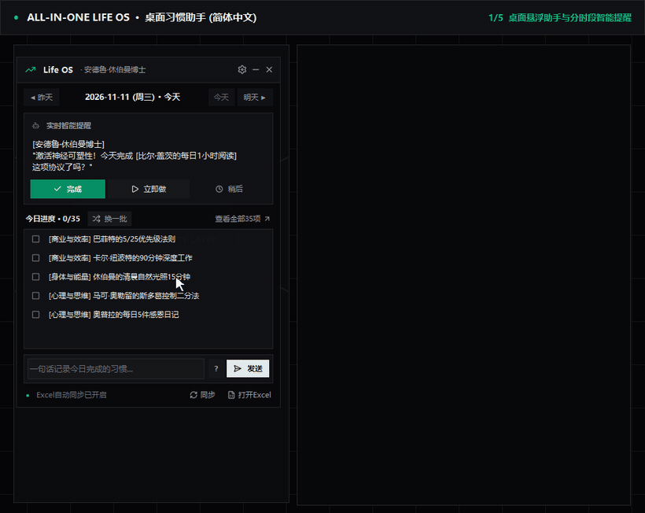

# 🌟 ALL-IN-ONE LIFE OS : 35项成功习惯与 AI 教练系统（Excel + 桌面悬浮窗）

> 🌐 **Languages:** [🇺🇸 English](README.md) · [🇰🇷 한국어](README.ko.md) · [🇯🇵 日本語](README.ja.md) · **🇨🇳 简体中文**

> **“卓越不是一种行为，而是一种习惯。” —— 亚里士多德**

---

## 🎬 功能演示视频（简体中文界面）



* 🎥 [MP4 高清视频 (`assets/demo_zh.mp4`)](assets/demo_zh.mp4) *(※ 演示视频略去了外部 Bot 令牌配置画面；Telegram · Discord · 局域网 Webhook 配置方法请参阅 [BOT_INTEGRATION_GUIDE.md](BOT_INTEGRATION_GUIDE.md)。)*

---

## 🎯 核心亮点

1. **7大人生领域 × 5项日常原则 = 35项科学成功习惯:**  
   涵盖商业效率、身体能量、心理思维、创造学习、人际领导力、财富理财与系统日常（完整文献来源见 [`REFERENCES.md`](REFERENCES.md)）。
2. **本地 SQLite 与 5表全自动公式 Excel 双向同步 (`Life_OS_Successful_Habits.xlsx`):**  
   `📊 仪表盘`、`🏆 成功习惯库`、`📅 每日追踪表`、`📈 每周复盘`、`🤖 AI助手日志` 实时联动，所有除法/均值公式均内置 `IFERROR` 防报错。
3. **轻量化桌面悬浮助手 (`LifeOS_Assistant_v2.exe`):**
   * **全局快捷键 (`Ctrl + Shift + H`)** 与系统托盘后台常驻
   * **实时横向透明度滑块 (`30%–100%`)**: 拖动滑块即可实时预览窗口半透明效果，未保存关闭自动还原
   * **分时段智能提醒 (`HABIT_ALLOWED_HOURS`)**: 晨间阳光、上午核心决策、凌晨写作、睡前戒屏、晚间关机等时间限定习惯仅在对应时段弹出，其余习惯保持随机推荐
   * **4位导师人格切換**: 安德鲁·休伯曼 / 沃伦·巴菲特 / 埃隆·马斯克 & Grok / 马可·奥勒留
   * **动态日期导航 (`◀ 昨天/前一天` · `今天` · `明天 ▶/后一天 ▶`)**: 切换到非当天日期时自动显示「前一天 / 后一天」，避免歧义
   * **4国语言自动检测与热切换 (`ko`/`en`/`ja`/`zh`)**: 支持在设置中实时切换 UI、托盘、数据库与 Excel 表格语言

---

## 🚀 快速开始

### 方式 A：Windows 免安装独立程序 (`.exe`)
从 GitHub **Releases** 下载 `LifeOS_Assistant_v2.exe` 直接双击运行（无需安装 Python，首次运行自动初始化本地数据库和 Excel）。

### 方式 B：从源码运行（Windows / macOS / Linux）
```bash
git clone <repository-url>
cd life-os-excel-ai
pip install -r requirements.txt

python main_app.py
# 命令行自然语言打卡示例:
python ai_secretary.py --checkin "早上晒太阳15分钟，完成90分钟深度工作！"
```

---

## 🔗 文档与隐私保护

* [🤖 Telegram / Discord / 手机快捷指令联动指南 (`BOT_INTEGRATION_GUIDE.md`)](BOT_INTEGRATION_GUIDE.md) *(含外部平台更新导致设置界面变化的提示说明)*
* [🛠️ 项目演进、开发历程与分工 (`DEVELOPMENT_HISTORY.md`)](DEVELOPMENT_HISTORY.md)
* [📚 科学文献与书籍参考 (`REFERENCES.md`)](REFERENCES.md) · [📐 Harness² 架构规范 (`HARNESS_SPEC.md`)](HARNESS_SPEC.md)
* 个人数据文件（`*.db`, `*.xlsx`, `.env`, `*.spec`, `build/`, `dist/`）均已在 `.gitignore` 中严格屏蔽，且 `build_exe.py` 内置自动打包内容审计 (`verify_clean_exe_bundle`)。

---

## 👥 共同贡献者 (Contributors)

* **[hobby-programmer-5000](https://github.com/hobby-programmer-5000)** — *Product Owner · 领域架构 · 真机测试*: 策划7大领域×35习惯体系与Excel本地数据主权理念，提出 Harness² 与桌面助手交互方向，主导真机/桌面使用体验评审（动态日期按钮、分时段智能提醒、实时横滑透明度条、Bot配置卡片排序）及开放接口/隐私边界决策。
* **[Gemini (Antigravity)](https://github.com/gemini-code-assist)** — *AI 结对编程工程师 · 全栈与自动化测试*: 实现全部Python核心引擎、SQLite WAL三向同步、Tkinter悬浮窗与托盘、4语言i18n、Telegram/Discord/局域网Webhook桥接、PyInstaller隐私打包校验、25项回归+7步E2E测试集、沙盒演示视频及多语言文档。
